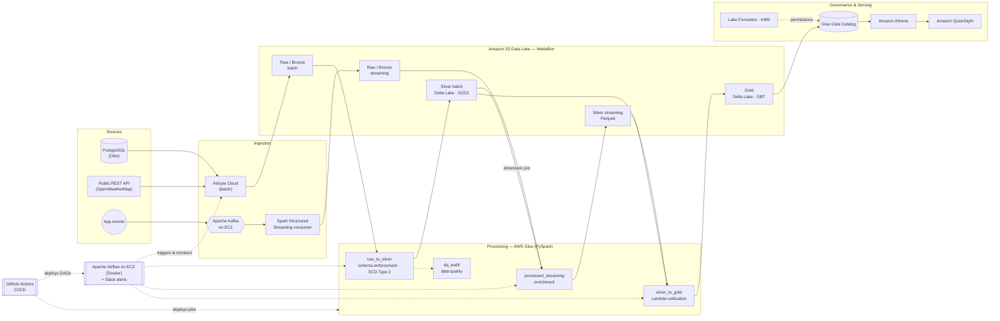

# PIM4: Production-Grade Cloud Data Lake

Welcome to the **PIM4 Data Lake** project. This repository contains the end-to-end implementation of a highly scalable, medallion-based data pipeline designed for business intelligence and telemetry event analysis using a Lambda Architecture.

---

## 1. System Overview

### Purpose
The PIM4 Data Lake is an industrial-scale data platform designed to bridge the gap between transactional databases (PostgreSQL), external APIs (OpenWeatherMap), and real-time telemetry events. It provides a centralized, high-quality source of truth for analytical consumption.

### Scope
- **Ingestion**: Multi-source extraction (Batch & Streaming).
- **Storage**: Multi-layered S3 Data Lake (Raw, Silver, Gold).
- **Transformation**: Distributed processing via PySpark on AWS Glue.
- **Governance**: Automated Data Quality (DQ) checks and security via KMS/Lake Formation.
- **Consumption**: Serverless analytics via Amazon Athena and visualization.

### Key Functionalities
- **Medallion Lifecycle**: Seamless progression from immutable Raw data to curated Business Gold layers.
- **Lambda Fusion**: Unified analytical views that merge historical batch data with real-time speed layer events.
- **SCD Management**: Slowly Changing Dimensions (Type 2) implementation for historical customer tracking.
- **Automated DQ**: Systematic verification of uniqueness, completeness, and schema integrity.

---

## 2. Architecture



> Batch (slow lane) and streaming (speed layer) paths converge in the Gold layer, where `silver_to_gold.py` deduplicates by `order_id` to serve a single analytical view. A more detailed design write-up is available in [`docs/Arquitectura_PIM4.md`](docs/Arquitectura_PIM4.md).

### Tech Stack

| Layer | Technology |
|---|---|
| Ingestion | Airbyte Cloud, Apache Kafka |
| Storage | Amazon S3, Delta Lake, Parquet |
| Processing | AWS Glue, PySpark, Spark Structured Streaming |
| Orchestration | Apache Airflow (Docker on EC2) |
| Governance | Glue Data Catalog, Lake Formation, KMS |
| Serving | Amazon Athena, Amazon QuickSight |
| Quality & CI/CD | Custom DQ framework, pytest, GitHub Actions |

### Components
- **Orchestration**: **Apache Airflow** (deployed in Docker on AWS EC2) coordinates the entire lifecycle.
- **Ingestion**: **Airbyte Cloud** for relational and API sources; **Apache Kafka** for streaming events.
- **Storage Layer**: **Amazon S3** organized in the Medallion pattern (Parquet/Delta format).
- **Processing Engine**: **AWS Glue (PySpark)** for massive parallel transformations.
- **Data Quality**: Custom Python DQ Framework for standardized assertions.
- **Serving Layer**: **Amazon Athena** (SQL) and **Amazon QuickSight** (Visualizations).

### Data Flow
1.  **Ingestion Phase**: Airbyte syncs data from Postgres and APIs to S3 `raw/batch/`. Kafka producers send telemetry to S3 `raw-streaming/`.
2.  **Silver Transition (Cleanse)**: Glue jobs perform schema enforcement, data type casting, and deduplication. Dimensions are enhanced with SCD Type 2 metadata.
3.  **Gold Transition (Curate)**: Complex joins are executed (using Broadcast optimizations). Data is aggregated into "One Big Table" (OBT) formats and merged into Delta Lake tables to ensure idempotency.
4.  **Consumption**: Analytical queries run on Athena, which reads the optimized Gold layer.

### Integrations
- **Airbyte Cloud API**: Programmatically triggered via Airflow PythonOperators.
- **AWS Glue API**: Orchestrated via GlueJobOperators with localized parameter passing.
- **Slack Alerting**: Automated notifications on pipeline failures via Webhooks.
- **CI/CD**: GitHub Actions for automated deployment of DAGs and Spark scripts.

---

## 3. Key Concepts

- **Medallion Architecture**: The division of data into Raw (Bronze/as-is), Silver (Cleaned/Enforced), and Gold (Business Aggregated) zones.
- **Lambda Architecture**: A hybrid design that processes batch data for high accuracy and streaming data for low latency, unifiying them in the serving layer.
- **SCD Type 2**: A data engineering pattern where history is preserved by adding versions (effective/end dates) to records instead of overwriting them.
- **One Big Table (OBT)**: A denormalization strategy used to minimize expensive JOIN operations in serverless query engines like Athena.
- **Schema Enforcement**: The practice of validating and correcting data structures at the Silver layer to prevent downstream corruption.

---

## 4. Assumptions

- **Cloud Native**: The system assumes an AWS environment with S3, Glue, Athena, and EC2 available.
- **Data Immutability**: The Raw layer is strictly read-only; any correction must occur in the Silver layer or via re-processing.
- **Daily Freshness**: Batch processes are designed for a 24-hour delivery cycle, while the Speed Layer provides near real-time updates (minutes).
- **Idempotency**: All transformation jobs are idempotent; re-running a job for the same period will overwrite or merge data without creating duplicates.
- **Security**: Access is controlled via IAM roles; sensitive data is encrypted at rest using AWS KMS.

---

## 5. Repository Structure

```
├── .github/workflows/     # CI/CD: deploy Airflow DAGs and Glue jobs
├── orchestration/dags/    # Airflow DAGs (master pipeline + backfill)
├── spark/                 # Glue/Spark jobs: raw→silver, silver→gold, streaming, DQ audit, Delta maintenance
├── src/                   # Shared library: transformations, raw validator, DQ framework
├── tests/                 # pytest unit tests for Silver and Gold logic
├── infrastructure/        # AWS setup scripts: KMS, Lake Formation, Athena views, crawlers, lifecycle
├── docs/                  # Architecture design, technical specs, runbook, implementation guides
└── docker-compose.yaml    # Local / EC2 Airflow stack
```

---
*Author: [Maximiliano Falco](https://www.linkedin.com/in/maximilianofalco/) — Henry Data Engineering Bootcamp, Module 4 integration project.*
